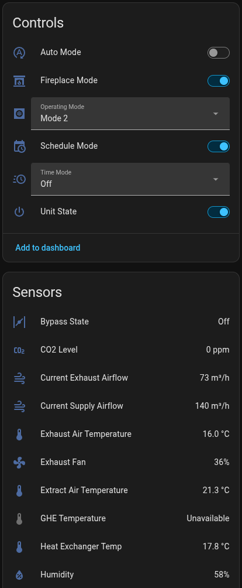

# Alnor ecoNet Custom Component for Home Assistant

An unofficial custom integration for Alnor Heat Recovery Units (HRU) connected to the ecoNet cloud (air.alnor.com.pl). It talks to the unit over the same live MQTT channel the Alnor web portal uses, so Home Assistant shows current values and can control the unit.

## Overview

### Custom Dashboard

### Integration Device View

## Key Features

* **Live data:** values are read from the unit directly and the unit pushes changes every few seconds, so a mode changed on the wall panel or in the Alnor app shows up in Home Assistant almost immediately.
* **Real control state:** Unit State, Auto Mode, Schedule Mode, Operating Mode and Time Mode reflect what the unit actually reports.
* **Automatic fallback:** if the live channel is unavailable, sensor values are taken from the (delayed) cloud archive until it comes back.
* **Self-healing authentication:** AWS Cognito sessions are refreshed and re-established automatically.
* **Comprehensive sensor suite:** inlet/exhaust/supply/extract temperatures, fan percentages, airflows, bypass state, CO2 and humidity.

## Installation

### Marketplace (Home Assistant 2026.11 and newer)

1. In Home Assistant go to **Settings** > **Marketplace**.
2. In the upper-right corner select **Add from link**.
3. Enter `https://github.com/scavara/alnor-econet-ha` (or `scavara/alnor-econet-ha`). Adding a repository by link requires connecting the Marketplace to your GitHub account the first time.
4. Install **Alnor ecoNet (HRU)** and restart Home Assistant.

### HACS (Home Assistant 2026.10 and older)

1. Open **HACS** > **⋮** (top right) > **Custom repositories**.
2. Paste `https://github.com/scavara/alnor-econet-ha`, choose type **Integration** and click **Add**.
3. Find **Alnor ecoNet (HRU)** in HACS, click **Download**, then restart Home Assistant.

### Manual

1. Copy the `custom_components/alnor_econet` directory into your Home Assistant `config/custom_components` directory.
2. Restart Home Assistant.

## Configuration

1. Go to **Settings** > **Devices & Services** > **Add Integration** and search for **Alnor ecoNet**.
2. Enter:
   * **Email / Password** – your [air.alnor.com.pl](https://air.alnor.com.pl) account.
   * **Installation ID** and **Factory number** – open your unit in the Alnor web portal and read them from the address bar: `/i/<installation_id>/details/...`. The installation ID is a GUID; the factory number is the unit's serial number shown in the portal.

Your credentials are stored only in your Home Assistant config entry and are sent only to the Alnor / ecoNet cloud.

## Limitations

* **Fireplace Mode is unverified.** The meaning of the values the unit reports for this register has not been confirmed, so the switch state may be wrong.
* **Archive fallback is delayed.** While the live channel is down, values come from the cloud archive, which the unit only updates about every 15 minutes, and the control switches show as unknown.
* This is an unofficial integration, not affiliated with or endorsed by Alnor or Plum. It relies on an undocumented cloud API that may change without notice.

## Dashboard Configuration

To replicate the ultra-wide, multi-axis ApexCharts dashboard layout shown in the screenshot above, please follow the detailed instructions in the [Dashboard Setup Guide](DASHBOARD.md).
