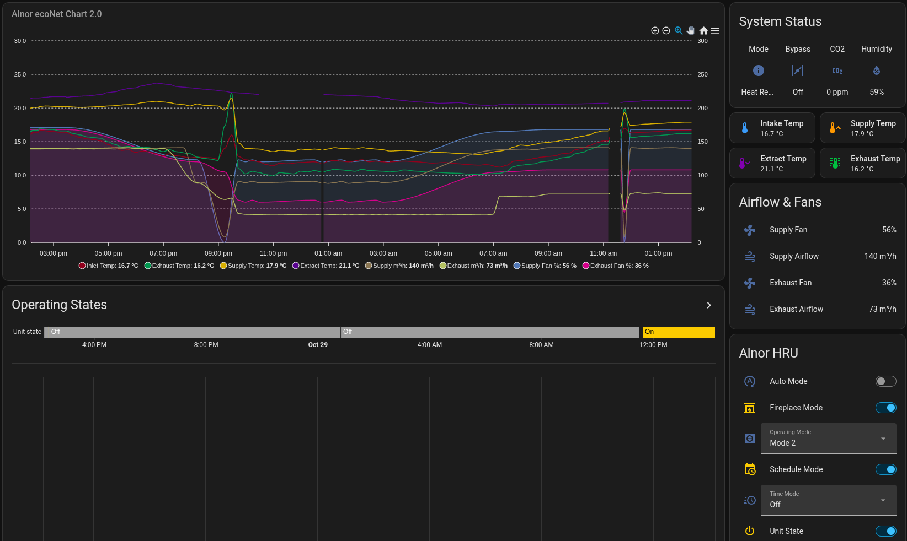

# Alnor ecoNet Custom Component for Home Assistant

A robust, fully-featured custom integration for Alnor Heat Recovery Units (HRU) utilizing the ecoNet web platform. This integration establishes a reliable connection to the Alnor AWS Cognito backend and Archives API to bring complete monitoring and control of your recuperator into Home Assistant.

## Overview

### Custom Dashboard

### Integration Device View

## Key Features

* **Bulletproof Authentication:** Integrates native AWS Cognito session management with a self-healing background re-authentication mechanism to gracefully handle 30-day refresh token invalidations.
* **Instant UI Feedback:** Values changed from Home Assistant are shown immediately and held until the cloud archive confirms them, masking the archive's upload lag.
* **Bitmask State Tracking:** Intelligently reads the underlying `u7151` bitmask register to accurately report the true state of write-only toggles (Fireplace, Schedule, Auto Mode) upon boot.
* **Comprehensive Sensor Suite:** Tracks inlet/exhaust temperatures, supply/exhaust fan percentages, actual m³/h airflows, bypass state, CO2 levels, and humidity.
* **Full Control Set:** Toggle Unit Power, Auto Mode, Fireplace Mode, Schedule Mode, and adjust Operating / Time modes via dropdowns.

## Installation

### HACS (recommended)

1. In Home Assistant open **HACS** > **⋮** (top right) > **Custom repositories**.
2. Paste `https://github.com/scavara/alnor-econet-ha`, choose type **Integration** and click **Add**.
3. Find **Alnor ecoNet (HRU)** in HACS, click **Download**, then restart Home Assistant.

### Manual

1. Copy the `custom_components/alnor_econet` directory into your Home Assistant `config/custom_components` directory.
2. Restart Home Assistant.

## Configuration

1. Go to **Settings** > **Devices & Services** > **Add Integration** and search for **Alnor ecoNet**.
2. Enter:
   * **Email / Password** – your [air.alnor.com.pl](https://air.alnor.com.pl) account.
   * **Installation ID** and **Factory number** – open your unit in the Alnor web portal and read them from the address bar: `/i/<installation_id>/details/...`. The installation ID is a GUID; the factory number is the unit's serial number shown in the portal.

Your credentials are stored only in your Home Assistant config entry and are sent only to the Alnor / ecoNet cloud.

## Limitations

* **Data is delayed.** The unit uploads readings to the cloud archive in batches roughly every 15 minutes, so a change made on the unit itself (wall panel, Alnor app) can take that long to appear in Home Assistant.
* This is an unofficial integration, not affiliated with or endorsed by Alnor or Plum. It relies on an undocumented cloud API that may change without notice.

## Dashboard Configuration

To replicate the ultra-wide, multi-axis ApexCharts dashboard layout shown in the screenshot above, please follow the detailed instructions in the [Dashboard Setup Guide](DASHBOARD.md).
